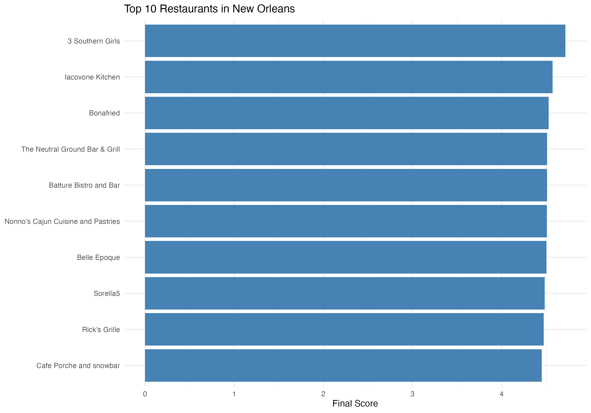
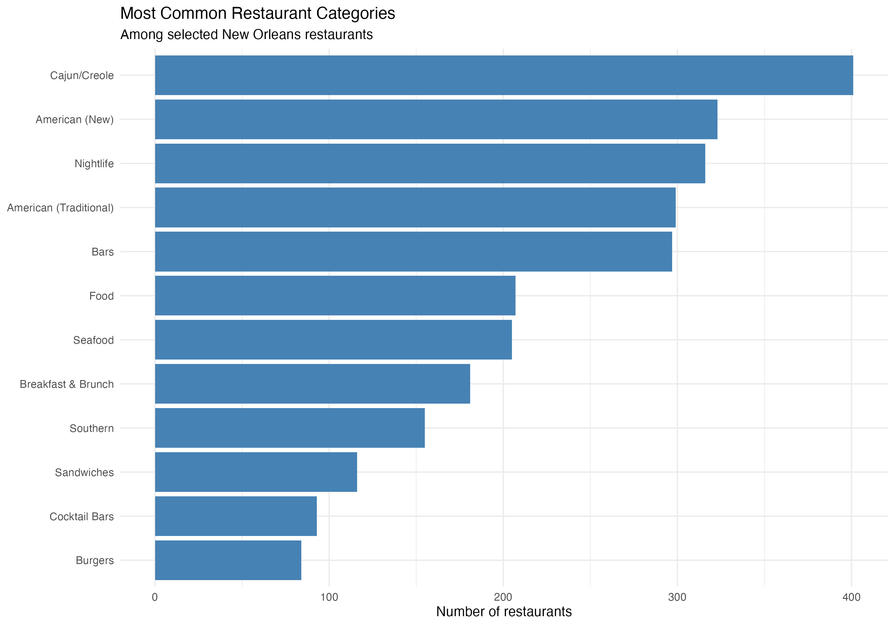
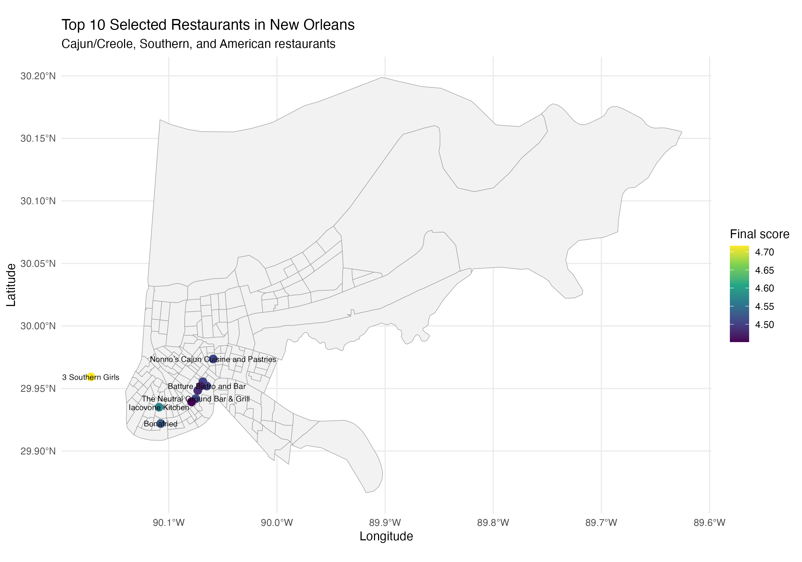

# Finding the Best Restaurants in New Orleans

## Project Overview

This project analyzes Yelp business and review data to identify the best restaurants in New Orleans based on rating quality, review support, and reviewer-adjusted performance.

The goal was to avoid ranking restaurants using star ratings alone. Restaurants with very few reviews can appear highly rated by chance, so this analysis combines multiple measures to create a more reliable ranking.

## Research Question

Which restaurants in New Orleans have the strongest combination of high ratings, meaningful review volume, and consistent reviewer-adjusted performance?

## Data

The analysis uses the Yelp Open Dataset, including:

- Business information, locations, categories, star ratings, and review counts
- Individual restaurant reviews
- Louisiana geographic boundaries
- Official place boundaries and Census tract boundaries

The raw Yelp JSON files are not included because of their size. The analysis script expects them to be downloaded separately.

## Methodology

1. Filtered Yelp businesses to restaurants located in New Orleans.
2. Identified the most represented restaurant categories in the data.
3. Selected restaurants from the relevant categories based on their actual presence and frequency in the dataset.
4. Imported only reviews belonging to the selected restaurants.
5. Calculated reviewer-level averages to account for differences in how reviewers rate businesses.
6. Adjusted individual review scores toward the overall review average.
7. Aggregated the adjusted scores by restaurant.
8. Combined the reviewer-adjusted score with the original Yelp star rating to create a final score.
9. Ranked restaurants using the final score while requiring meaningful review support.
10. Compared restaurant locations across official place boundaries and Census tracts.
11. Created tables, charts, and maps to communicate the results.

## Final Score

The final score combines:

- 60% reviewer-adjusted score
- 40% original Yelp star rating

The reviewer adjustment reduces the influence of unusually generous or unusually harsh reviewers. This makes the ranking less dependent on who happened to review a restaurant.

Restaurants were also required to have at least 20 review rows for the final ranking.

## Key Findings

- The final ranking identified the 10 highest-scoring restaurants in the selected New Orleans restaurant sample.
- 3 Southern Girls received the highest final score in the final ranking.
- Cajun/Creole was the most common category in the selected restaurant data.
- The most common category combinations included American (New) with American (Traditional), and Cajun/Creole with Southern.
- Geographic joins successfully matched the selected restaurants to both official place boundaries and Census tracts.
- Census tracts provided a more detailed geographic system for comparing restaurant concentration across areas.

## Visual Results

### Top 10 Restaurants

### Restaurant Category Distribution

### Map of Top Restaurants

## Repository Files

- `project_analysis.R` — complete R analysis script
- `top_10_restaurants.csv` — final restaurant ranking
- `category_counts.csv` — restaurant category counts
- `category_pairs.csv` — category combinations appearing together
- `geography_comparison.csv` — comparison of geographic boundary systems
- `tract_summary.csv` — restaurant summaries by Census tract
- `top10_restaurants_plot.png` — final ranking visualization
- `category_plot.png` — category distribution visualization
- `top10_restaurants_map.png` — geographic visualization
- `new_orleans_business.rds` — filtered New Orleans business data
- `yelp-new-orleans-project.Rproj` — RStudio project file

## Tools

- R
- tidyverse
- jsonlite
- sf
- tigris
- ggplot2
- lubridate
- viridis

## Reproducibility Note

To reproduce the analysis, download the Yelp Open Dataset, update the file paths at the beginning of `project_analysis.R`, and run the script in RStudio.
